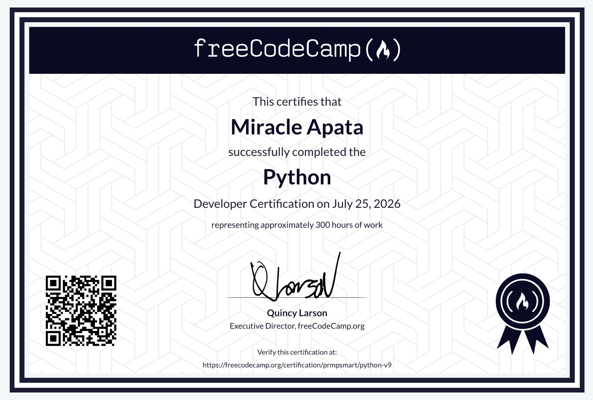

# 🧾 Miracle Apata – Developer Resume Collection

This repository contains curated, role-specific resumes written in Markdown format. Each resume highlights a unique specialization in my software development journey.

---

## 👋 About Me

I'm **Miracle Apata**, a software engineer who moves fluidly across mobile, backend, and desktop development rather than staying boxed into one lane. My work spans Flutter for cross-platform mobile apps, FastAPI/ASP.NET/Node.js for backend systems, Python for both APIs and desktop tooling, and PySide6/SwiftUI for native desktop experiences. I started programming with Python — self-taught after a CSC 201 course in 2018/2019 — and I work remotely with teams in Nigeria, Canada, Spain, and the USA, and have hands-on experience experimenting with C, C++, and OCaml.

I built this repo because a single one-size-fits-all resume doesn't do justice to that range — each file here is tailored to a specific role so it speaks directly to what that position actually needs, instead of making a reviewer dig for it.

<!-- Optional: replace with your own line(s) — e.g. what you're currently focused on, what kind of teams/projects you're looking for. -->

---

## 🛠️ Engineering Principles

I care about software that:

- Solves the real problem, not just the ticket
- Stays readable and maintainable as it grows
- Handles edge cases and failure without drama
- Performs well across the platforms it targets

<!-- Optional: adjust or extend this list to reflect how you actually work. -->

---

## 📂 Available Resumes

| Role                        | Filename                                                          | Description                                                             |
| ---------------------------- | ------------------------------------------------------------------ | -------------------------------------------------------------------------- |
| 📱 Mobile Engineer    | [resumes/mobile-engineer.md](./resumes/mobile-engineer.md)       | Flutter-based cross-platform mobile development                        |
| 🛠️ Backend Engineer   | [resumes/backend-engineer.md](./resumes/backend-engineer.md)     | FastAPI, ASP.NET, and Node.js/TypeScript backend systems                |
| 🐍 Python Engineer   | [resumes/python-engineer.md](./resumes/python-engineer.md)       | Python across backend APIs (FastAPI/Django) and PySide6 desktop apps    |
| 🖥️ Desktop Developer  | [resumes/desktop-engineer.md](./resumes/desktop-engineer.md)     | PySide6 and SwiftUI-based apps for Windows and macOS                    |
| 💻 Software Engineer  | [resumes/software-engineer.md](./resumes/software-engineer.md)   | Full-stack and systems development with cross-platform expertise        |

Each resume is also available as a two-page PDF in [`pdfs/`](./pdfs) (`Miracle-Apata-<Role>.pdf`), regenerated from the Markdown via `generate_pdfs.py`. For projects, case studies, and live apps, see the portfolio at [prmpsmart.github.io](https://prmpsmart.github.io).

---

## 🏆 Recognition & Certifications

_Certificate of Recognition — Outstanding Technical Contribution, awarded by TrackWeNg (December 2025) for contributions to building the platform now known as [Tywn](https://home.twynapp.org/)._

_[Python Developer Certification](https://www.freecodecamp.org/certification/prmpsmart/python-v9) — freeCodeCamp, July 2026 (~300 hours)._

---

## 🔎 Usage

- Browse the repo to view resumes per role under [`resumes/`](./resumes).
- Click on individual `.md` files to view each resume directly in GitHub, or grab the matching PDF from [`pdfs/`](./pdfs).
- To regenerate the PDFs after editing a resume: `python3 generate_pdfs.py` (requires `pandoc` and `typst`, e.g. `brew install pandoc typst`).

---

## 📬 Contact

If you'd like to collaborate, hire, or chat about any of these focus areas:

- **Email:** [prmpsmart@gmail.com](mailto:prmpsmart@gmail.com)
- **LinkedIn:** [linkedin.com/in/prmpsmart](https://linkedin.com/in/prmpsmart)
- **GitHub:** [github.com/prmpsmart](https://github.com/prmpsmart)
