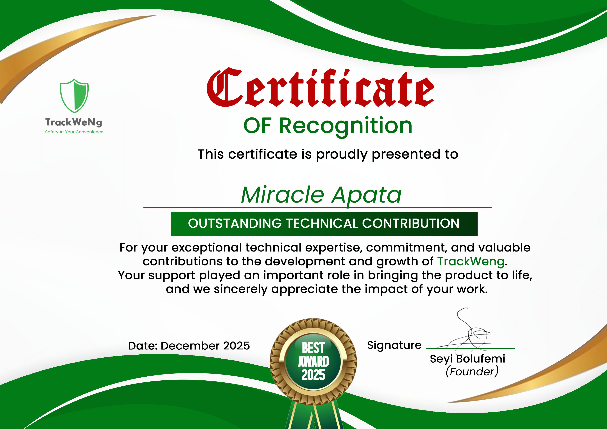

# 🧾 Miracle Apata – Developer Resume Collection

This repository contains curated, role-specific resumes written in Markdown format. Each resume highlights a unique specialization in my software development journey.

---

## 📂 Available Resumes

| Role                        | Filename                                                          | Description                                                             |
| ---------------------------- | ------------------------------------------------------------------ | -------------------------------------------------------------------------- |
| 📱 Mobile Engineer    | [resumes/mobile-engineer.md](./resumes/mobile-engineer.md)       | Flutter-based cross-platform mobile development                        |
| 🛠️ Backend Engineer   | [resumes/backend-engineer.md](./resumes/backend-engineer.md)     | FastAPI, ASP.NET, and Node.js/TypeScript backend systems                |
| 🐍 Python Developer   | [resumes/python-engineer.md](./resumes/python-engineer.md)       | Python across backend APIs (FastAPI/Django) and PySide6 desktop apps    |
| 🖥️ Desktop Developer  | [resumes/desktop-engineer.md](./resumes/desktop-engineer.md)     | PySide6 and SwiftUI-based apps for Windows and macOS                    |
| 💻 Software Engineer  | [resumes/software-engineer.md](./resumes/software-engineer.md)   | Full-stack and systems development with cross-platform expertise        |

Each resume is also available as a PDF in [`pdfs/`](./pdfs), regenerated from the Markdown via `generate_pdfs.py`.

---

## 🏆 Recognition

_Certificate of Recognition — Outstanding Technical Contribution, awarded by TrackWeNg (December 2025) for contributions to building the platform now known as [Tywn](https://home.twynapp.org/)._

---

## 🔎 Usage

- Clone or browse the repo to view resumes per role under [`resumes/`](./resumes).
- Copy or fork to reuse the Markdown templates for your own portfolio.
- Click on individual `.md` files to view each resume directly in GitHub, or grab the matching PDF from [`pdfs/`](./pdfs).
- To regenerate the PDFs after editing a resume: `python3 generate_pdfs.py` (requires `pandoc` and `typst`, e.g. `brew install pandoc typst`).

---

## 📬 Contact

If you'd like to collaborate, hire, or chat about any of these focus areas:

- **Email:** [prmpsmart@gmail.com](mailto:prmpsmart@gmail.com)
- **LinkedIn:** [linkedin.com/in/prmpsmart](https://linkedin.com/in/prmpsmart)
- **GitHub:** [github.com/prmpsmart](https://github.com/prmpsmart)
